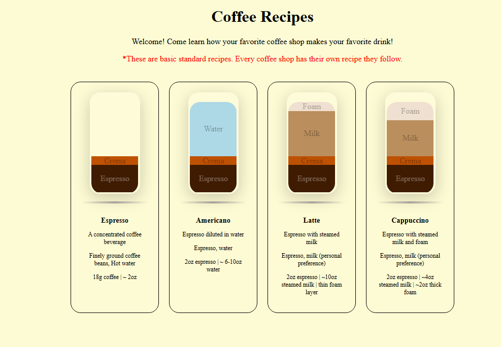

# Coffee Recipes 

## Preview

## About the Project

Coffee Recipes is a beginner web development project inspired by my experience working as a barista. The goal was to build a simple, visual guide that helps people understand how popular espresso-based drinks are made.

I wanted to combine my existing knowledge of coffee with my developing programming skills to create something useful while learning how HTML, CSS, and JavaScript work together to build a website.

## My Original Vision

My initial vision was to create a menu of popular espresso-based drinks, including Espresso, Americano, Latte, and Cappuccino.

I wanted each drink to have its own card containing a visual representation of the drink's layers, along with a description, ingredients, and basic recipe specifications. I also wanted the liquid layers to have distinct colors so visitors could visually understand the composition of each drink.

As the project developed, I focused on making the cards consistent, keeping the layout organized, and dynamically generating the content rather than manually building every card in HTML.

## What I Accomplished

- Built a webpage using HTML, CSS, and JavaScript.
- Created a JavaScript array of objects to store drink names, descriptions, ingredients, specifications, and layer data.
- Wrote a reusable function that generates drink cards dynamically from the stored data.
- Used DOM manipulation to create and assemble HTML elements through JavaScript.
- Created visual representations of drink layers using CSS and dynamically assigned colors and heights.
- Added labels to individual layers, with automatic text capitalization and styling.
- Used Flexbox to organize the page, align text, and control the order and positioning of liquid layers.
- Styled the drink cards and glass-like containers to create a consistent visual presentation.

## Challenges and What I Learned

### Connecting JavaScript to the DOM

One of my biggest learning experiences was understanding how JavaScript interacts with HTML elements. I practiced selecting elements, creating new elements, assigning classes and text content, and appending elements to the page.

This helped me better understand how JavaScript can dynamically change what a user sees in the browser.

### Building Reusable Components

Instead of manually writing the HTML for every drink card, I used an array of objects and a function to generate them. This taught me how separating data from presentation makes a project easier to maintain and expand.

Adding another drink can now be as simple as adding another object to the array.

### CSS Layout and Flexbox

Getting the cards and drink layers to look the way I envisioned required experimentation with widths, heights, spacing, and Flexbox properties.

One particularly challenging part was arranging the liquid layers in the correct order while keeping shorter drinks, such as Espresso, positioned at the bottom of the glass. Working through this helped me understand how `flex-direction`, `justify-content`, and `align-items` interact.

### Debugging and Problem-Solving

Throughout the project, I encountered issues with styling, layer order, and dynamically generated elements. Rather than treating each issue as an isolated mistake, I used the debugging process to improve my understanding of how the different parts of the application work together.

## Version 1 — Complete

I consider Version 1 complete because it accomplishes the original purpose of the project and demonstrates the concepts I wanted to practice.

The finished version includes dynamically generated drink cards, colored liquid layers, layer labels, drink descriptions, ingredients, and recipe specifications.

I could continue refining the styling and adding features, but I decided that moving on to new projects would provide more learning opportunities at this stage of my development.

**Complete does not mean perfect. It means the project has achieved its current purpose.**

## Future Plans — Version 2

I plan to revisit Coffee Recipes in the future after gaining more experience with JavaScript, CSS, and web development.

A future version may include improvements to the visual design, more drink recipes, additional interactions, and a more detailed representation of how different coffee drinks are prepared as well as refactoring my JS logic.

For now, this project serves as a milestone in my journey as a self-taught developer: taking an idea, turning it into a working application, debugging problems, and deciding when it is time to move forward.

## Technologies Used

- HTML
- CSS
- JavaScript
